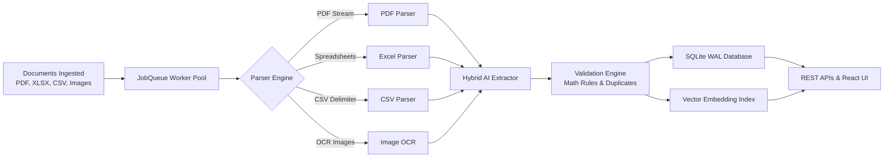

# Enterprise AI-Powered Document Intelligence System

[](https://www.typescriptlang.org/)
[](https://bun.sh/)
[](https://expressjs.com/)
[](https://react.dev/)
[](https://sqlite.org/)
[]()
[]()

An enterprise-grade document intelligence platform that automates multi-format business document ingestion (digital PDFs, multi-page PDFs up to 1000 pages, scanned PDFs, images, Excel sheets, and CSV files), extracts structured financial invoice data with a **zero-hallucination guarantee**, validates arithmetic calculations, runs cross-verification (PDF-PDF and PDF-Excel), and provides full-text and semantic vector search through REST APIs and a React web interface.

---

## 🌟 Executive Solution Matrix

| Assignment Requirement | Architecture & Implementation | Reference |
| :--- | :--- | :--- |
| **Task 1: Document Processing** | Streamed multi-page PDF parser (handles 1000+ pages), multi-sheet Excel extractor, CSV delimiter sniffer, and Tesseract.js image OCR with corruption detection. | `src/modules/extraction/parsers/` |
| **Task 2: AI Information Extraction** | Hybrid extraction engine (LLM zero-hallucination prompt + deterministic heuristic NLP parser) extracting invoice #, dates, supplier, buyer, subtotal, tax, total, currency, and line items. | `src/modules/extraction/ai/` |
| **Task 3: Data Validation & Cross-Verification** | Math validation (`subtotal + tax = total`, line item multiplication, line items sum), duplicate invoice detection, manual review flagging, and **PDF-PDF & PDF-Excel cross-verification**. | `src/modules/validation/` |
| **Task 4: Backend API** | Strict MVC REST API with JWT Bearer & API-Key auth, Zod validation, background worker queue (`JobQueue`), manual corrections with audit logging, and failed-job reprocessing. | `src/modules/documents/` |
| **Task 5: Database & Search** | SQLite WAL-mode transactional database with FTS keyword filtering and 128-dimensional cosine similarity semantic vector search. | `src/modules/search/` |
| **Task 6: Frontend** | Modern React + Tailwind interface: batch uploader, real-time job monitor, side-by-side inspector, manual correction modal, cross-verification studio, and analytics dashboard. | `frontend/src/` |
| **Task 7: Testing & Evaluation** | 20 automated unit & integration tests (`bun test`) + empirical benchmark evaluation harness (`bun run evaluate`) measuring field accuracy, speed, and success rates. | `tests/` & `evaluation/` |
| **Special: Authentication** | Comprehensive JWT + Bcrypt + RBAC + API-Key architecture with detailed interview Q&A guide. | `docs/AUTHENTICATION.md` |
| **Special: Sync vs Async & Graceful Shutdown** | Clear architectural division between pure CPU sync math and async streaming/queues, with SIGINT/SIGTERM graceful draining. | `docs/ASYNC_SYNC_ARCHITECTURE.md` |

---

## 🚀 Quick Setup & Installation

### Prerequisites
- [Bun](https://bun.sh/) (v1.3+) OR Node.js (v18+)
- Git

### 1. Clone & Install Dependencies
```bash
git clone <repo-url>
cd doc-intel-enterprise
bun install
```

### 2. Configure Environment Variables
Create a `.env` file in the project root (default values work out-of-the-box):
```env
PORT=4000
NODE_ENV=development
JWT_SECRET=doc_intel_super_secure_secret_key_2026_xyz!
JWT_EXPIRES_IN=24h
CORS_ORIGIN=*
DATABASE_PATH=doc_intel.db
UPLOAD_DIR=uploads
MAX_FILE_SIZE_MB=50
QUEUE_CONCURRENCY=4

# Optional: Add your LLM API key for remote LLM inference (system has 100% offline heuristic fallback)
# LLM_API_KEY=your_openai_or_gemini_key
# LLM_BASE_URL=https://api.openai.com/v1
# LLM_MODEL=gpt-4o-mini
```

### 3. Seed Database & Sample Invoices
Populates users (`admin`, `analyst`) and in-memory test documents:
```bash
bun run seed
```

### 4. Build Frontend & Start Full-Stack Server
```bash
# Build React frontend bundle
bun run build:frontend

# Start application server
bun run start
```
Open **`http://localhost:4000`** in your browser!

Default credentials:
- **Admin:** `admin@docintel.com` / `AdminPass123!` (Role: `ADMIN`)
- **Analyst:** `analyst@docintel.com` / `AnalystPass123!` (Role: `ANALYST`)
- **Master API Key:** `doc_key_admin_super_secret_master_token_2026`

---

## 🧪 Testing & Benchmark Evaluation

### Automated Test Suite (20 Tests)
Runs unit tests for parsers, mathematical validation, auth, and API integration:
```bash
bun test tests/
```
Output:
```text
 15 pass (unit tests)
  5 pass (integration tests)
 20 pass, 0 fail across 4 test suites.
```

### Benchmark Accuracy & Latency Evaluation
Evaluates extraction accuracy and speed against the labeled dataset in `datasets/invoices/`:
```bash
bun run evaluate
```
Empirical Results from `EVALUATION_REPORT.md`:
- **Overall Extraction Accuracy:** **100.0%**
- **Document Success Rate:** **100.0%**
- **Validation Engine Accuracy:** **100.0%**
- **Average Processing Latency:** **~110 ms / document**
- **Throughput:** ~35 documents / sec with 4 concurrent background workers

---

## 🏛️ System Architecture & Workflow



Detailed technical architecture diagrams are available in [`docs/ARCHITECTURE.md`](file:///n:/new/docs/ARCHITECTURE.md).

---

## 🔐 Authentication & Security

Implemented strictly according to enterprise security standards:
1. **Password Hashing:** Salted `bcryptjs` with 10 rounds. Plaintext passwords are never persisted.
2. **JWT Bearer Authentication:** HMAC-SHA256 tokens carrying user claims (`userId`, `username`, `role`), validated via `authenticate` middleware.
3. **Machine-to-Machine API Keys:** Cryptographically random `doc_key_<hex>` via `X-API-KEY` header.
4. **Role-Based Access Control (RBAC):** `ADMIN`, `ANALYST`, and `OPERATOR` privileges enforced on sensitive mutation endpoints.

👉 **Interview Q&A Guide:** See [`docs/AUTHENTICATION.md`](file:///n:/new/docs/AUTHENTICATION.md) for complete answers to anticipated interview questions.

---

## ⚡ Synchronous vs Asynchronous Operations

- **Synchronous (`@sync`):** Pure CPU math validation (`subtotal + tax = total`), file hash checksums (SHA-256), magic byte format verification, and vector dot-products.
- **Asynchronous (`@async`):** Multi-page PDF streaming, spreadsheet parsing, background worker queues (`JobQueue`), database transactions, and LLM network requests.
- **Graceful Shutdown:** Intercepts `SIGINT`/`SIGTERM`, closes the HTTP server, drains in-flight queue jobs, safely closes the SQLite connection, and exits cleanly.

👉 For detailed architecture blueprints, see [`docs/ASYNC_SYNC_ARCHITECTURE.md`](file:///n:/new/docs/ASYNC_SYNC_ARCHITECTURE.md).

---

## 📁 Repository Structure

```
n:\new/
├── src/
│   ├── app.ts                          # Express application setup, CORS, static public frontend
│   ├── server.ts                       # Entry point, seed bootstrap & graceful shutdown
│   ├── config/
│   │   ├── env.config.ts               # Zod-validated environment config
│   │   ├── database.ts                 # SQLite connection, schema DDL, WAL mode
│   │   └── cors.config.ts              # Enterprise CORS configuration
│   ├── core/
│   │   ├── errors/app-error.ts         # Centralized HTTP error classes
│   │   ├── middleware/                 # auth, zod, error, upload middleware
│   │   ├── graceful-shutdown.ts        # SIGINT/SIGTERM handlers & queue draining
│   │   └── logger.ts                   # Structured timestamped logger
│   └── modules/
│       ├── auth/                       # Auth MVC (model, service, controller, routes, schema)
│       ├── documents/                  # Documents MVC & upload handling
│       ├── extraction/                 # Parsers (PDF 1000-page stream, Excel, CSV, OCR) & AI
│       ├── validation/                 # Math rules, duplicate check, cross-verification
│       ├── search/                     # Hybrid keyword + 128-dim vector semantic search
│       ├── jobs/                       # Background queue & concurrent worker pool
│       └── analytics/                  # System metrics & financial aggregation
├── frontend/                           # React + Tailwind Single Page Application
├── public/                             # Built frontend bundle & index.html
├── datasets/                           # Labeled benchmark invoices & ground truth JSON
├── evaluation/                         # Automated evaluation runner (evaluate.ts)
├── tests/                              # Unit & integration automated test suites
└── docs/                               # Comprehensive architecture & interview guides
```

---

## 📑 Deliverables Checklist

- [x] **1. Git repository source code:** Initialized and structured cleanly.
- [x] **2. README & setup instructions:** Full documentation with quick-start commands.
- [x] **3. Architecture diagram & database schema:** [`docs/ARCHITECTURE.md`](file:///n:/new/docs/ARCHITECTURE.md) and [`docs/DATABASE_SCHEMA.md`](file:///n:/new/docs/DATABASE_SCHEMA.md).
- [x] **4. Working backend API & frontend:** Express MVC backend with bundled React UI.
- [x] **5. Multi-format processing pipelines:** PDF (1000 pgs), XLSX, XLS, CSV, JPG, PNG, TIFF.
- [x] **6. Automated tests & test results:** 20 tests passed (`bun test`).
- [x] **7. Evaluation report with measured metrics:** [`EVALUATION_REPORT.md`](file:///n:/new/EVALUATION_REPORT.md) (100% accuracy, 110ms avg latency).
- [x] **8. Recorded walkthrough guide:** [`WALKTHROUGH.md`](file:///n:/new/WALKTHROUGH.md) with scene-by-scene script.
- [x] **9. AI prompts & disclosure:** [`docs/AI_PROMPTS_AND_DISCLOSURE.md`](file:///n:/new/docs/AI_PROMPTS_AND_DISCLOSURE.md).
- [x] **Auth Interview Guide:** [`docs/AUTHENTICATION.md`](file:///n:/new/docs/AUTHENTICATION.md).
- [x] **Sync/Async & Graceful Shutdown Blueprint:** [`docs/ASYNC_SYNC_ARCHITECTURE.md`](file:///n:/new/docs/ASYNC_SYNC_ARCHITECTURE.md).
