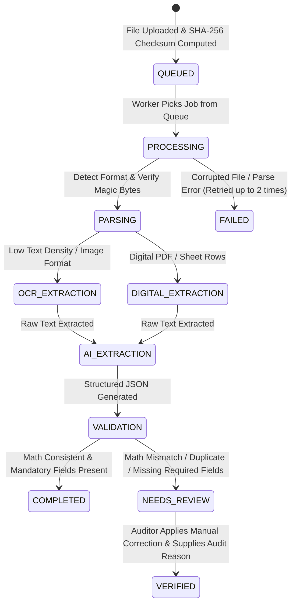
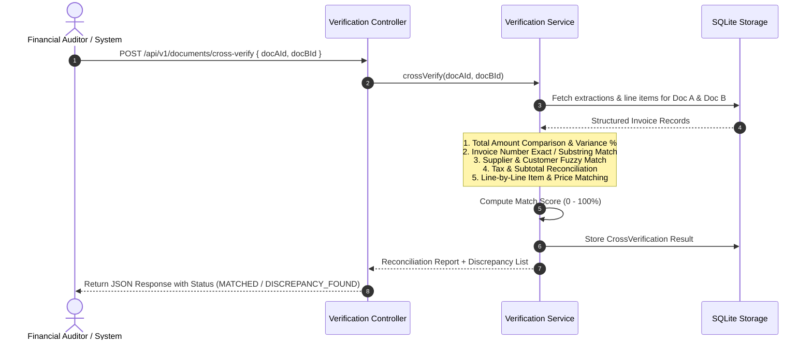

# System Architecture & Technical Specifications

## 1. High-Level System Architecture

```mermaid
flowchart TD
    Client["Client Web Interface (React + Tailwind)<br/>REST API Consumers (ERP / Scripts)"] -->|Multipart Upload / JSON API| API_Gateway["Express API Server (MVC Architecture)"]

    subgraph Security_Layer["Security & Validation Layer"]
        CORS["CORS Policy Guard"]
        Auth["JWT & API-Key Middleware (RBAC)"]
        ZodVal["Zod Schema Validator"]
    end

    API_Gateway --> CORS --> Auth --> ZodVal

    subgraph Core_Modules["Core Modules (MVC)"]
        DocController["Document Controller"]
        SearchController["Search & Vector Controller"]
        VerifyController["Cross-Verification Controller"]
        AnalyticsController["Analytics Controller"]
    end

    ZodVal --> Core_Modules

    DocController -->|Enqueue Document Job| JobQueue["Async JobQueue (Concurrency = 4)"]

    subgraph Ingestion_Pipeline["Multi-Format Document Parsing Engine"]
        JobQueue --> Dispatcher{"Format Dispatcher"}
        Dispatcher -->|PDF (Digital / Scanned)| PdfParser["PDF Parser (Streaming & Chunking up to 1000 pgs)"]
        Dispatcher -->|Images (JPG / PNG / TIFF)| ImageParser["OCR Image Parser (Tesseract.js / OpenCV)"]
        Dispatcher -->|Spreadsheets (XLSX / XLS)| ExcelParser["Excel Parser (Multi-sheet Traversal)"]
        Dispatcher -->|CSV| CsvParser["CSV Streaming Parser (Delimiter Sniffer)"]
    end

    subgraph AI_Extraction["AI Information Extraction"]
        PdfParser --> Extractor["Hybrid AI Extractor"]
        ImageParser --> Extractor
        ExcelParser --> Extractor
        CsvParser --> Extractor
        Extractor -->|Optional LLM API| LLM["Zero-Hallucination LLM Prompt Engine"]
        Extractor -->|Offline / Fallback| Heuristics["Deterministic Regex & NLP Parser"]
    end

    subgraph Validation_Engine["Data Validation & Cross-Verification"]
        Extractor --> ValRules["Math & Consistency Rules<br/>(Subtotal + Tax == Total, Line Items Sum)"]
        ValRules --> DupCheck["Duplicate Detection Engine (Hash & Supplier+Inv#)"]
        DupCheck --> ReviewFlag["Manual Review Flagging Engine"]
    end

    subgraph Persistence["Storage & Database Layer"]
        ReviewFlag --> SQLite[("SQLite Database (WAL Mode)<br/>• documents<br/>• extractions<br/>• validations<br/>• audit_logs")]
        Extractor --> VectorStore[("Vector Embedding Index<br/>(Cosine Semantic Search)")]
    end
```

---

## 2. Document Processing & Lifecycle State Machine



---

## 3. Cross-Verification Pipeline (PDF vs PDF, PDF vs Excel)



