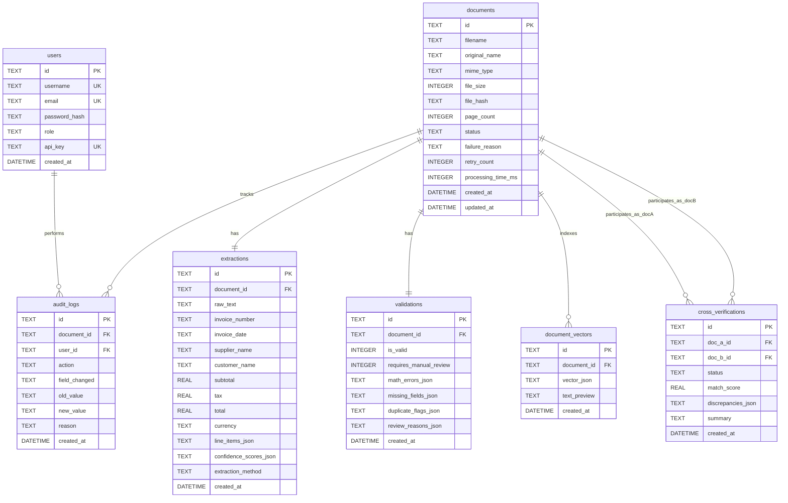

# Database Schema Specification

## 1. Entity-Relationship Diagram (ERD)

---

## 2. Table Schemas & Indexing Strategy

### 1. `users` Table
Stores authentication credentials, hashed passwords, roles, and programmatic API keys.
- **Indexes:** `UNIQUE(username)`, `UNIQUE(email)`, `UNIQUE(api_key)`
- **Roles:** `ADMIN`, `ANALYST`, `OPERATOR`

### 2. `documents` Table
Stores metadata, file size, SHA-256 deduplication hash, page count, and processing status.
- **Statuses:** `QUEUED`, `PROCESSING`, `COMPLETED`, `NEEDS_REVIEW`, `VERIFIED`, `FAILED`
- **Indexes:**
  - `idx_documents_file_hash` ON `documents(file_hash)`
  - `idx_documents_status` ON `documents(status)`
  - `idx_documents_created_at` ON `documents(created_at)`

### 3. `extractions` Table
Contains structured financial data extracted by the hybrid AI pipeline.
- **Columns:** `invoice_number`, `invoice_date`, `supplier_name`, `customer_name`, `subtotal`, `tax`, `total`, `currency`, `line_items_json`, `confidence_scores_json`.
- **Indexes:**
  - `idx_extractions_invoice_num` ON `extractions(invoice_number)`
  - `idx_extractions_supplier` ON `extractions(supplier_name)`

### 4. `validations` Table
Maintains mathematical validation results, missing mandatory field alerts, duplicate flags, and manual review requirements.

### 5. `audit_logs` Table
Provides an immutable ledger of every manual correction applied by auditors: who performed it, what field was updated, old value vs new value, mandatory justification reason, and timestamp.

### 6. `cross_verifications` Table
Maintains reconciliation history comparing Document A (PDF) with Document B (PDF or Excel), storing match scores and detailed discrepancies.

### 7. `document_vectors` Table
Maintains normalized semantic term vectors for semantic similarity queries and cosine distance calculation.

